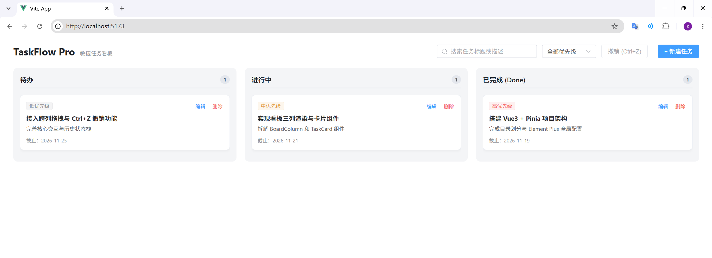
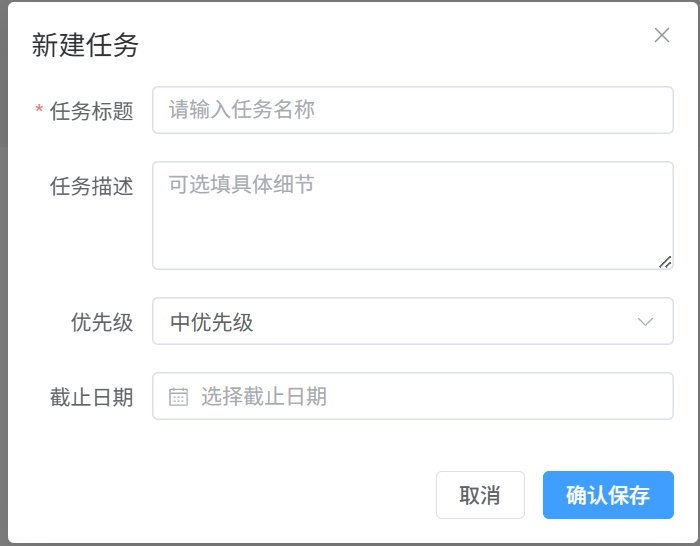

# TaskFlow Pro — 敏捷任务管理看板

基于 **Vue 3 (Composition API) + Pinia + Element Plus** 构建的轻量级敏捷任务管理看板，支持任务全生命周期管理、多条件组合检索、原生 HTML5 跨列拖拽流转以及基于操作快照栈的 `Ctrl + Z` 历史撤销功能。

## 界面预览




## 技术栈

* **核心框架**：Vue 3 (`<script setup>` 组合式 API)
* **状态管理**：Pinia (Setup Store 模式)
* **UI 组件库**：Element Plus + `@element-plus/icons-vue`
* **构建工具**：Vite
* **数据持久化**：Web Storage API (`LocalStorage`)

## 核心功能与工程亮点

1. **三列看板与组件化拆分**：拆解为 `BoardColumn`（看板列）与 `TaskCard`（任务卡片）高内聚子组件，通过 `defineProps` 与 `defineEmits` 实现单向数据流，使用工厂函数隔离引用类型默认属性，避免多列数据污染。
2. **原生 HTML5 跨列拖拽**：基于浏览器原生 `Drag & Drop API`（`draggable`、`dataTransfer`）实现无第三方拖拽库依赖的跨状态列任务流转与悬停高亮反馈。
3. **操作快照栈（`Ctrl + Z` 撤销）**：在 Pinia 仓库中维护最多 15 步的深拷贝历史状态栈（Memento 模式），支持通过全局键盘快捷键 `Ctrl + Z`（自动避让输入框打字状态）或顶部按钮一键回退误删及状态变更操作。
4. **毫秒级组合检索**：利用 `computed` 计算属性实现“关键词模糊匹配（标题/描述不区分大小写）+ 优先级筛选”的多条件实时联动过滤，不破坏原始数据。
5. **本地自动持久化**：结合 Pinia 与 `watch` 深度监听，所有增删改及拖拽操作自动同步至 `LocalStorage`，刷新页面数据不丢失。

## 目录结构

```text
src/
├── components/
│   ├── BoardColumn.vue   # 单列看板组件（统计数量、拖拽接收区）
│   └── TaskCard.vue      # 任务卡片组件（优先级标签、编辑/删除、拖拽起点）
├── stores/
│   └── taskStore.js      # Pinia 全局任务状态仓库、快照历史栈与本地持久化
├── App.vue               # 主视图布局、多条件筛选逻辑、新建/编辑弹窗与键盘监听
└── main.js               # 应用入口与插件注册

# 安装依赖
npm install

# 启动开发服务器
npm run dev

# 生产环境打包
npm run build

